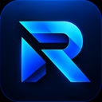
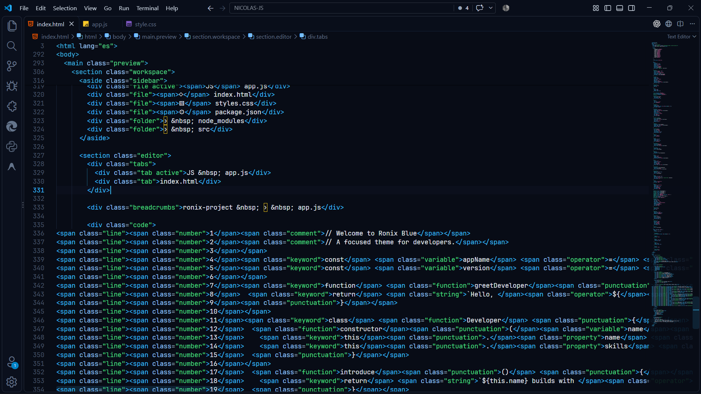
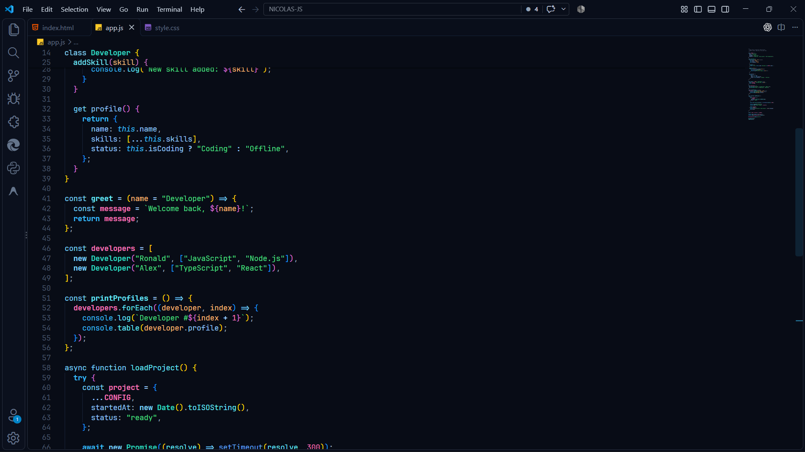
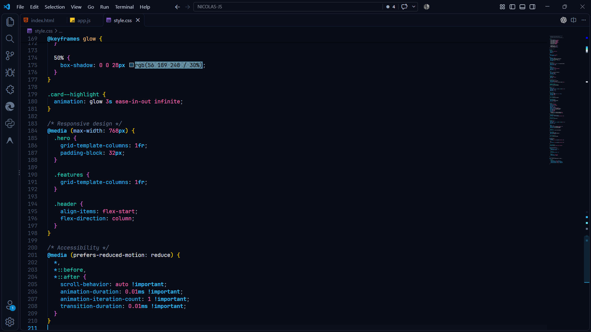

# Ronix Blue 🌌

<p align="center">
  
</p>

<p align="center">
  <strong>Un tema oscuro profesional, limpio y moderno para Visual Studio Code.</strong><br>
  <em>Fondo azul casi negro, paneles azul marino profundo, detalles celestes brillantes y una sintaxis viva pero equilibrada.</em>
</p>

<p align="center">
  <a href="#español">Español</a> • <a href="#english">English</a> • <a href="#paleta-de-colores--color-palette">Paleta de Colores</a> • <a href="#instalación-y-pruebas-locales--local-testing">Instalación y Pruebas</a> • <a href="#empaquetado-y-publicación--packaging--publishing">Empaquetado y Publicación</a>
</p>

---

## Vista previa

### Vista general



### JavaScript



### CSS



---

## Español

### ✨ Características

- **Fondo casi negro con tinte azul profundo (`#080c16`)**: Proporciona el máximo confort visual reduciendo la fatiga ocular durante largas sesiones de programación.
- **Paneles azul marino (`#0d1424` / `#0b101d`)**: Jerarquía clara y elegante entre el explorador, la barra de actividad, pestañas y la terminal integrada.
- **Acentos celestes y cyan neón (`#38bdf8` / `#00d2ff`)**: Indicadores limpios y precisos en cursores, pestañas activas, botones y bordes enfocados.
- **Selección azul translúcida (`#1d4ed850`)**: Selección clara que resalta el código sin oscurecer los caracteres seleccionados.
- **Sintaxis viva pero armónica**: Diseñada para equilibrar legibilidad y contraste en todos los lenguajes principales (TypeScript, JavaScript, Python, Go, Rust, HTML, CSS, C++, JSON, Markdown).
- **Compatibilidad con Semantic Highlighting**: Aprovecha las capacidades semánticas modernas de VS Code para una colorización contextual precisa.

---

### 🎨 Paleta de Colores / Color Palette

| Elemento / Element          | Color Hex             | Muestra / Preview | Descripción / Description                 |
| :-------------------------- | :-------------------- | :---------------: | :---------------------------------------- |
| **Editor Background**       | `#080c16`             |        `■`        | Fondo principal azul casi negro           |
| **Side Bar Background**     | `#0d1424`             |        `■`        | Azul marino profundo para paneles         |
| **Activity Bar & Terminal** | `#0b101d`             |        `■`        | Fondo para barras y paneles secundarios   |
| **Accent / Cyan Neon**      | `#38bdf8`             |        `■`        | Celeste brillante para cursores y acentos |
| **Selection Blue**          | `#1d4ed850`           |        `■`        | Selección azul de alto contraste          |
| **Keywords & Control**      | `#38bdf8`             |        `■`        | Palabras clave y control de flujo         |
| **Functions & Methods**     | `#67e8f9` / `#60a5fa` |        `■`        | Funciones, métodos e invocaciones         |
| **Types & Classes**         | `#2dd4bf`             |        `■`        | Tipos, clases, interfaces y structs       |
| **Strings**                 | `#4ade80`             |        `■`        | Cadenas de texto en verde menta fresco    |
| **Numbers & Constants**     | `#f472b6`             |        `■`        | Números y constantes en rosa suave        |
| **Booleans & Special**      | `#fb923c`             |        `■`        | Booleanos, null y undefined en naranja    |
| **Parameters**              | `#fdba74`             |        `■`        | Parámetros de función en melocotón suave  |
| **Variables**               | `#f1f5f9`             |        `■`        | Variables base en blanco azulado suave    |
| **Comments**                | `#64748b`             |        `■`        | Comentarios legibles en pizarra itálica   |

---

### 🚀 Instalación y Pruebas Locales

Tienes dos métodos sencillos para probar y usar **Ronix Blue** localmente:

#### Método 1: Modo de Desarrollo (Recomendado para previsualizar al instante)

1. Abre esta carpeta en Visual Studio Code.
2. Presiona la tecla **`F5`** (o ve a _Run > Start Debugging_).
3. Se abrirá una nueva ventana llamada `[Extension Development Host]`.
4. En esa ventana, abre cualquier archivo de código (JavaScript, Python, TypeScript, etc.).
5. Abre la paleta de comandos (`Ctrl+Shift+P` en Windows/Linux o `Cmd+Shift+P` en macOS) y escribe:
   ```text
   Preferences: Color Theme
   ```
6. Selecciona **Ronix Blue**. ¡Cualquier cambio que guardes en el archivo JSON se reflejará al recargar la ventana!

#### Método 2: Instalación manual mediante paquete `.vsix`

1. Empaqueta la extensión ejecutando:
   ```powershell
   npx @vscode/vsce package --allow-missing-repository
   ```
2. Instala el archivo `.vsix` generado con el comando de VS Code:
   ```powershell
   code --install-extension ronix-blue-1.0.0.vsix
   ```
   _O desde la interfaz:_ Abre VS Code > pestaña **Extensiones** (`Ctrl+Shift+X`) > Menú de 3 puntos (`...`) en la esquina superior > **Install from VSIX...** y selecciona `ronix-blue-1.0.0.vsix`.

---

### 📦 Empaquetado y Publicación en VS Code Marketplace

#### 1. Configurar tu identificador de publicador (`publisher`)

En `package.json`, cambia el valor `"publisher"` por tu Publisher ID registrado en el Marketplace:

```json
"publisher": "tu-identificador-real"
```

> **¿Cómo crear un Publisher ID oficial?**
>
> 1. Inicia sesión en el portal de [Visual Studio Marketplace Management Portal](https://marketplace.visualstudio.com/manage).
> 2. Haz clic en **Create publisher**.
> 3. Ingresa tu ID (ejemplo: `ronaldhuaira`) y nombre para mostrar.
> 4. Copia ese ID exacto en el campo `"publisher"` de `package.json`.

#### 2. Configurar la URL de tu repositorio

En `package.json`, actualiza los enlaces de GitHub con tu usuario:

```json
"homepage": "https://github.com/tu-usuario/ronix-blue#readme",
"repository": {
  "type": "git",
  "url": "https://github.com/tu-usuario/ronix-blue.git"
},
"bugs": {
  "url": "https://github.com/tu-usuario/ronix-blue/issues"
}
```

#### 3. Empaquetar con `@vscode/vsce`

Para generar el archivo `.vsix`:

```powershell
npx @vscode/vsce package
```

#### 4. Publicar la extensión

Cuando estés listo para publicar en el Marketplace (requiere un Personal Access Token de Azure DevOps):

```powershell
npx @vscode/vsce publish
```

_También puedes subir manualmente el archivo `.vsix` generado directamente desde la web en [marketplace.visualstudio.com/manage](https://marketplace.visualstudio.com/manage)._

---

### ⚙️ Configuración Recomendada de VS Code

Para una experiencia óptima con **Ronix Blue**, se recomienda agregar lo siguiente a tu archivo `settings.json`:

```json
{
  "workbench.colorTheme": "Ronix Blue",
  "editor.fontFamily": "'Fira Code', 'JetBrains Mono', 'Cascadia Code', Consolas, monospace",
  "editor.fontLigatures": true,
  "editor.fontSize": 14,
  "editor.lineHeight": 22,
  "editor.cursorBlinking": "smooth",
  "editor.cursorSmoothCaretAnimation": "on",
  "editor.bracketPairColorization.enabled": true,
  "editor.guides.bracketPairs": "active"
}
```

---

<br>

## English

### ✨ Features

- **Deep Blue-Black Background (`#080c16`)**: Maximum visual comfort engineered to reduce fatigue during extended coding sessions.
- **Navy Blue Panels (`#0d1424` / `#0b101d`)**: Crisp architectural separation between editor, activity bar, sidebar, and integrated terminal.
- **Electric Cyan & Sky Blue Accents (`#38bdf8` / `#00d2ff`)**: Sleek indicators across cursor, active tabs, buttons, and focused elements.
- **Translucent Blue Selection (`#1d4ed850`)**: Clean contrast that keeps highlighted text perfectly readable.
- **Vibrant yet Balanced Syntax**: Hand-tuned harmony across TypeScript, JavaScript, Python, Go, Rust, HTML, CSS, C++, JSON, Markdown, and more.
- **Semantic Highlighting Enabled**: Native support for modern VS Code semantic tokens.

---

### 🚀 Local Testing & Installation

#### Option 1: Development Host (Live Preview)

1. Open this repository folder in VS Code.
2. Press **`F5`** (or select _Run > Start Debugging_).
3. In the new `[Extension Development Host]` window, open any project file.
4. Press `Ctrl+Shift+P` / `Cmd+Shift+P` and choose:
   ```text
   Preferences: Color Theme -> Ronix Blue
   ```

#### Option 2: Package and Install `.vsix`

1. Package the extension:
   ```powershell
   npx @vscode/vsce package --allow-missing-repository
   ```
2. Install the package:
   ```powershell
   code --install-extension ronix-blue-1.0.0.vsix
   ```

---

### 📦 Marketplace Publishing Guide

1. **Update Publisher ID:** Edit `"publisher"` in `package.json` with your verified Marketplace publisher name.
2. **Update Git URLs:** Replace repository placeholders with your actual GitHub links.
3. **Package:** Run `npx @vscode/vsce package`.
4. **Publish:** Run `npx @vscode/vsce publish` or drag-and-drop the generated `.vsix` into the [Visual Studio Marketplace Management Portal](https://marketplace.visualstudio.com/manage).

---

### 📄 License

Este proyecto está bajo la Licencia MIT. Consulta el archivo [LICENSE](LICENSE) para más detalles.

Copyright (c) 2026 Ronald Huaira.
